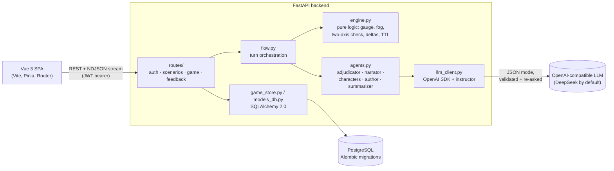

# TRPG Drama Engine

[](https://github.com/torisu233/trpg-drama-engine/actions/workflows/ci.yml)
[](LICENSE)

A multi-agent LLM game engine where a **state ledger and LLM adjudication replace dice rolls** — built as a full-stack, tested, continuously deployed web app.

Players co-write a tabletop-style scene with AI-controlled allies and opponents. Instead of hit points and probability tables, every action is judged by a neutral adjudicator agent against an explicit ledger of facts ("bound hands", "afraid of fire", "promised not to attack during the talks"), and the outcome is written back to the ledger as a structured delta.

The core design idea is that **LLM output is untrusted input**: models propose, deterministic code disposes.

## Highlights

- **Structured LLM outputs with automatic re-asking.** Every agent call goes through [instructor](https://github.com/567-labs/instructor) + Pydantic schemas; validation errors are fed back to the model and retried ([`backend/llm_client.py`](backend/llm_client.py)).
- **Separation of powers between agents.** Character agents can only express intent; only the adjudicator may change state, and only through a typed `ledger_delta`. The engine resolves model-supplied names to ids at the boundary and never indexes state with raw LLM keys.
- **Three-layer test suite.** Pure-logic unit tests, API integration tests against a real PostgreSQL (auth boundaries: 401 / 403 / 404-without-leaking-existence), and offline **LLM-contract tests** that drive a full turn with a hostile-but-schema-valid fake model — written after real production incidents.
- **CI/CD with keyless cloud auth.** GitHub Actions runs the suite against a Postgres service container, then builds a multi-stage Docker image and deploys. Deployed first to AWS (ECR + ECS Express + RDS, via GitHub OIDC), later migrated to GCP (Artifact Registry + Cloud Run + Cloud SQL, via Workload Identity Federation). No long-lived cloud keys anywhere.
- **Multi-user web app.** FastAPI + SQLAlchemy 2.0 + Alembic (migrations run on container start), bcrypt + JWT auth, per-user ownership and private/published visibility, Vue 3 SPA.
- **Streaming gameplay.** Each turn streams as NDJSON snapshots; player-visible parts are revealed as soon as they exist while adjudication and narration are still running, without leaking hidden enemy intent.

> The hosted demo has been shut down. The deploy job is disabled unless the repository variable `DEPLOY_ENABLED` is `true`; see [docs/deployment.md](docs/deployment.md) for how it worked.

## Architecture



| Module | Responsibility |
|---|---|
| `backend/models.py` | Pydantic models: world, character cards, ledger, session, scenario, and every LLM input/output schema |
| `backend/engine.py` | Framework-free pure functions: action gauge, two-axis reaction/contest check, fog-of-war views, delta application, TTL expiry, name→id resolution, session invariants |
| `backend/agents.py` | Prompt assembly for the adjudicator, narrator, character intent/reaction, summarizer, ledger consolidation and authoring agent |
| `backend/flow.py` | Turn loop as a generator: intent → (reaction) → adjudication → delta → narration → distribution → per-turn maintenance |
| `backend/llm_client.py` | Single LLM entry point (`call(prompt, Schema)`), provider-neutral via `LLM_*` env vars |
| `backend/routes/` | REST API: auth, scenario CRUD + authoring, stateful play with streaming, user↔admin feedback |
| `backend/auth.py`, `models_db.py`, `game_store.py` | bcrypt/JWT auth, ORM tables (soft delete + JSON columns), persisted game sessions and snapshots |
| `alembic/` | Versioned schema migrations, applied on container start |
| `frontend/` | Vue 3 SPA: login, scenario library, authoring page (editable panel + chat), play page |

## Testing

```bash
pip install -r requirements-dev.txt
docker compose up -d --wait      # PostgreSQL for the integration tests (host port 5433)
pytest                           # runs with coverage (see pyproject.toml)
```

**Strategy: test the deterministic machine exhaustively; isolate the non-deterministic LLM.** No test calls a real model, so the suite runs offline and CI needs no secrets. Current CI run: **117 tests, 89% line coverage** of `backend/` (live diagnostic scripts excluded).

| Layer | Files | What it covers |
|---|---|---|
| Unit | `test_engine.py`, `test_flow.py`, `test_scenario.py` | Gauge scheduling, fog-of-war visibility, the two-axis rules (parametrized), delta application, TTL expiry, summarization/consolidation triggers (LLM monkeypatched), scenario round-trips and merge semantics |
| Integration | `test_api.py` | FastAPI `TestClient` against a real PostgreSQL test database (isolated with `TRUNCATE … RESTART IDENTITY`): register/login, scenario CRUD, visibility and ownership, game ownership returning 404 so existence isn't leaked |
| LLM contract | `test_llm_contract.py` | A `FakeLLM` returns schema-valid but hostile output — characters keyed by display name, `self:<name>` visibility, keys for characters that don't exist — and drives a complete turn. Guards the class of bugs that only appear at the free-form-LLM ↔ strict-code boundary; reverting the boundary fix reproduces the original production `KeyError`. |
| Prompt assembly | `test_agents.py` | Captures assembled prompts with a fake client and asserts the right sections are present or absent |

Prompt *quality* is deliberately not unit-tested; it is checked with live diagnostic scripts (`backend/mode_test.py`, `backend/author_test.py`) that call the real model and are excluded from CI. Details: [tests/README.md](tests/README.md).

## CI/CD & deployment

[`.github/workflows/ci.yml`](.github/workflows/ci.yml):

1. **test** — every push and PR: Python 3.13, pip cache, PostgreSQL 16 service container, `pytest` with coverage.
2. **deploy** — `master` only, after tests pass (now gated by `vars.DEPLOY_ENABLED`): build the multi-stage image (Node builds the SPA, a slim non-root Python image serves API + static files), push it tagged with the git SHA, deploy that exact SHA.

The deployment evolved in two phases:

| | AWS (June 2026) | GCP (July 2026) |
|---|---|---|
| Registry | Amazon ECR | Artifact Registry |
| Compute | ECS Express Mode (Fargate + ALB + HTTPS) | Cloud Run (scale to zero) |
| Database | RDS PostgreSQL in private subnets | Cloud SQL via the built-in unix-socket connector |
| Network | Custom VPC: public app subnet, private DB subnet, no NAT gateway | No VPC needed |
| CI auth | GitHub OIDC → IAM role | Workload Identity Federation → service account |

The application and migrations needed no changes for the move: both read a single `DATABASE_URL`. Full write-up, including the reasoning behind each choice: [docs/deployment.md](docs/deployment.md).

## Running locally

Requirements: Python 3.13, Node 20, Docker (for PostgreSQL), and an API key for any OpenAI-compatible endpoint.

```bash
python -m venv .venv && source .venv/bin/activate     # Windows: .venv\Scripts\activate
pip install -r requirements-dev.txt
cp .env.example .env                                  # set LLM_API_KEY; set ADMIN_PASSWORD for a local admin

docker compose up -d --wait                           # PostgreSQL on 5433 (+ adminer on 8888)
alembic upgrade head

uvicorn backend.main:app --reload --port 8100         # API + Swagger UI at http://127.0.0.1:8100/docs

cd frontend && npm install && npm run dev             # http://localhost:5173 (proxies /api to 8100)
```

Register an account, create a scenario on the authoring page (chat with the authoring agent or fill in the panel), then play. [`scenarios/greywater-bridge.json`](scenarios/greywater-bridge.json) is a compact demo scenario you can load through the API, and [the reference scenario](scenarios/example-fantasy-broken-sword-inn.json) shows every field populated.

## How the engine works

Design document: [docs/design.md](docs/design.md). In short:

- **Two-layer state.** Static data (world tone/background/**laws**, dual-purpose character cards) is separated from the mutable **ledger** (posture, conditions, status effects, items, spatial/scene/social facts). Only the adjudicator changes the ledger, via `ledger_delta`.
- **Dual-purpose character cards.** Acting fields (personality, voice, motive, tactics) drive the character agent; adjudication fields (abilities, defenses, weaknesses) are seen only by the adjudicator and the character itself — so a weakness like "afraid of fire" is a secret players can discover and exploit.
- **Action gauge instead of rigid turns.** Each character accumulates gauge at a speed derived from its current state; at the threshold it acts and keeps the overflow, so long-run action ratios equal speed ratios. Injuries slow you down on the very next tick.
- **Two-axis check.** Axis A: should the target get a reaction (does it perceive the action, can it resist, is it the player)? Axis B: is the outcome genuinely contested (hidden luck oracle)? The two are independent.
- **Forced reasoning protocol.** The adjudicator must list relevant conditions, rule on each, choose an outcome on a ladder (`success` / `success_with_cost` / `reversal`), emit the delta, and decide who perceived what (`perception_map`).
- **Fog of war.** Every fact has a visibility (`public`, `gm`, `faction:<faction>`, `self:<id>`); each agent only sees the view it can perceive. Covert actions can be seen through — the adjudicator decides and may produce a cover story.
- **Long-scene maintenance.** Transient conditions expire after a TTL, a consolidation pass triggered by code-side thresholds merges near-duplicate facts (added after live experiments showed the model would not reliably de-duplicate when merely asked to in the prompt), and per-character rolling summaries keep context bounded.
- **Authoring agent.** A stateless agent edits one block of the scenario per turn; changes are merged field by field ("empty means unchanged") so it can never wipe content by omission.

## API overview

All `/api/*` routes except `/api/health`, `/api/auth/register` and `/api/auth/login` require `Authorization: Bearer <jwt>`. Interactive docs at `/docs`.

| Area | Endpoints |
|---|---|
| Auth | `POST /api/auth/register`, `POST /api/auth/login`, `GET /api/auth/me`, `POST /api/auth/change-password` |
| Scenarios | `GET/POST /api/scenarios`, `GET/PUT/DELETE /api/scenarios/{id}`, `POST /api/scenarios/{id}/copy`, `POST /api/author/turn` |
| Play | `GET /api/games`, `POST /api/game/new`, `GET /api/game/{id}`, `POST /api/game/{id}/action` (NDJSON stream), `POST /api/game/{id}/react` (NDJSON stream), `POST /api/game/{id}/continue` (resume after a failed stream), `GET /api/game/{id}/suggest`, `DELETE /api/game/{id}` |
| Feedback | `GET/POST /api/feedback`, `GET /api/feedback/threads`, `GET/POST /api/feedback/{user_id}` (admin) |

## License

[MIT](LICENSE)
